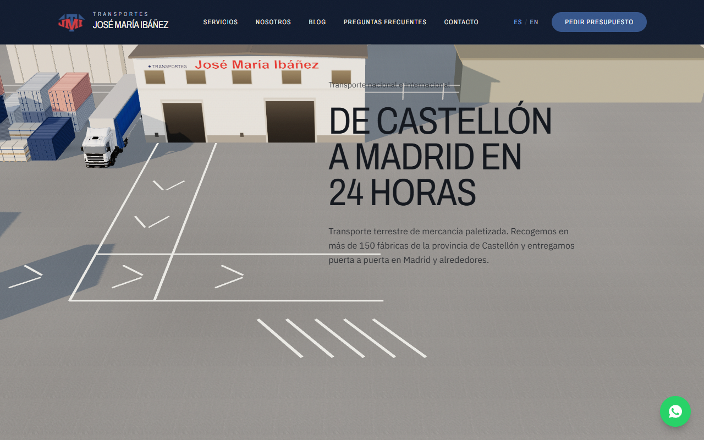
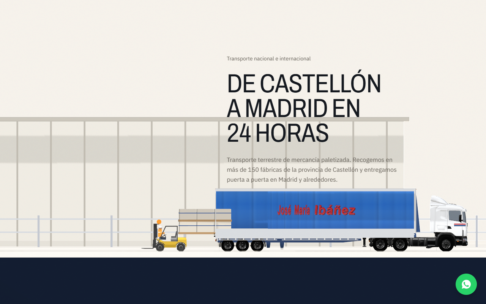

# Transportes José María Ibáñez

Web corporativa para una empresa de transporte por carretera de Castellón, con una intro 3D que avanza con el scroll.

*Corporate website for a Spanish road-freight company, with a scroll-driven 3D intro. Built with Next.js, React Three Fiber and GSAP.*

<p>
  
  
</p>

## Qué hace

- **Intro 3D ligada al scroll.** El camión entra en el patio de la sede, una carretilla carga los palés de azulejo y el camión sale hacia la ruta Castellón ⇄ Madrid. Cada momento de la escena corresponde a un punto del scroll.
- **Español e inglés**, con rutas por idioma.
- **Captación de clientes.** Formulario de presupuesto que llega por correo y botón de WhatsApp. Si el correo no está configurado, el formulario envía la solicitud por WhatsApp en vez de perderla.
- **Contenido completo:** servicios, cobertura con el mapa de la red, blog, preguntas frecuentes, quiénes somos y páginas legales.
- **Funciona sin 3D.** Sin WebGL o con movimiento reducido activado, la escena no se monta y la página se adapta a su contenido.
- **Avisos de errores.** Los fallos que rompen una página o la escena se envían a un webhook, con un límite por hora.

## Stack

| | |
|---|---|
| Framework | Next.js 16 (App Router), React 19, TypeScript |
| 3D | Three.js con React Three Fiber y drei |
| Animación | GSAP + ScrollTrigger, Lenis para el scroll suave |
| Estilos | Tailwind CSS 4 |
| Idiomas | next-intl |
| Formularios | React Hook Form + Zod, envío con Resend |

## Decisiones técnicas

- **Una sola partitura para el scroll.** Los tramos de scroll que comparten la escena 3D y los textos de la página están definidos una vez, con nombre, en [`src/lib/partitura.ts`](src/lib/partitura.ts). Así la escena y los textos no pueden desincronizarse.
- **Rendimiento medido, no supuesto.** Los 17 contenedores del patio se dibujan con instancias y las plazas pintadas son una sola geometría. Quitar un efecto de sombras que volvía a renderizar la escena entera bajó el peor fotograma de 673 a 285 llamadas de dibujo, sin cambio visible en la imagen.
- **Sin recursos de terceros.** El entorno que da los reflejos se genera dentro de la escena en lugar de descargar un HDRI externo.
- **Regresión visual automática.** `npm run check:3d` captura momentos clave de la intro y los compara píxel a píxel con las referencias de [`tests/visual/baseline`](tests/visual/baseline).

## Calidad

GitHub Actions ejecuta en cada push y pull request el lint, la comprobación de las fotos, el build, una prueba de que la web construida arranca y responde, y `npm audit`.

Además hay comprobaciones propias:

| Comando | Qué comprueba |
|---|---|
| `npm run check:3d` | Que la escena 3D se ve igual que las referencias |
| `npm run check:seo` | El título, la descripción y los metadatos que sirve de verdad cada página |
| `npm run check:fotos` | Que cada foto tiene resolución suficiente para el hueco que ocupa |
| `npm run check:formulario` | El formulario de presupuesto de principio a fin, en el navegador |
| `npm run check:errores` | Que navegar como un visitante real no deja errores en la consola |

## Puesta en marcha

Requiere Node.js 20.9 o superior.

```bash
npm install
cp .env.example .env.local
npm run dev
```

La web abre en http://localhost:3000. Las variables de entorno son opcionales en local; [`.env.example`](.env.example) explica cada una:

| Variable | Para qué sirve |
|---|---|
| `RESEND_API_KEY`, `PRESUPUESTO_TO`, `PRESUPUESTO_FROM` | Envío del formulario de presupuesto por correo |
| `AVISOS_WEBHOOK` | Dirección a la que se envían los avisos de errores |

## Estructura

```
src/
  app/[locale]/     páginas, una carpeta por ruta
  app/api/          envío del presupuesto y de los avisos de errores
  components/3d/    la escena: cámara, coreografía y modelos
  components/       secciones de la página y componentes de interfaz
  content/          blog y fotos
  lib/              utilidades compartidas (partitura del scroll, correo, SEO…)
  messages/         textos en español e inglés
scripts/            comprobaciones propias
tests/              medidas de rendimiento y referencias visuales
```

## Autoría

Desarrollada por [Radu Oancea](https://github.com/Radzl) para Transportes José María Ibáñez. El código se publica como muestra de trabajo. Los textos, las fotos, el logotipo y la marca pertenecen a la empresa y no se pueden reutilizar.
